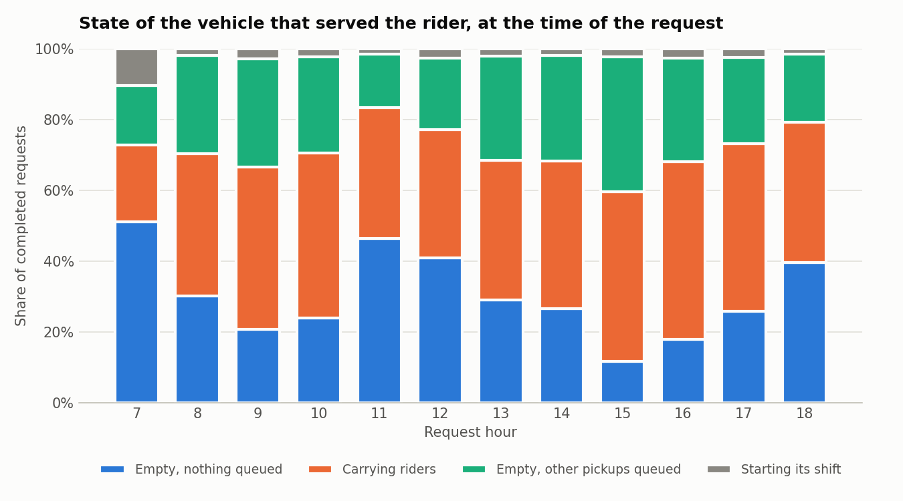
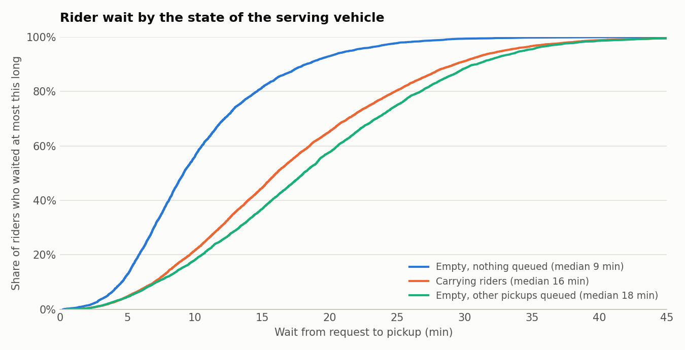
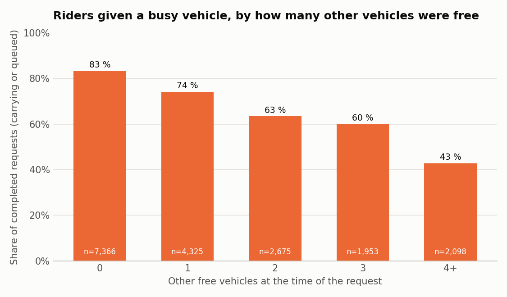
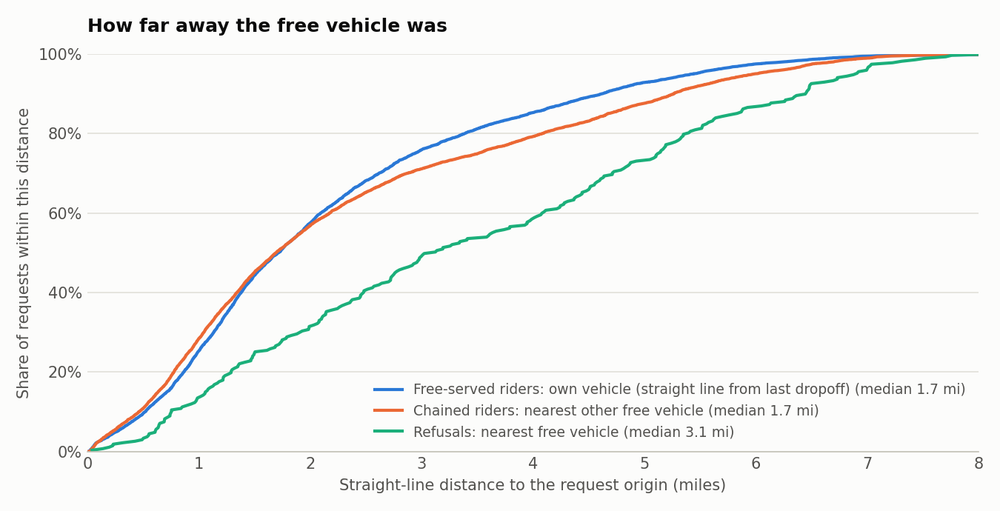
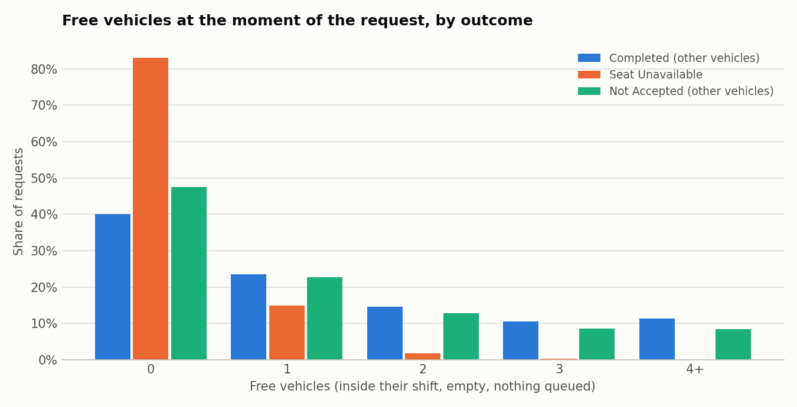
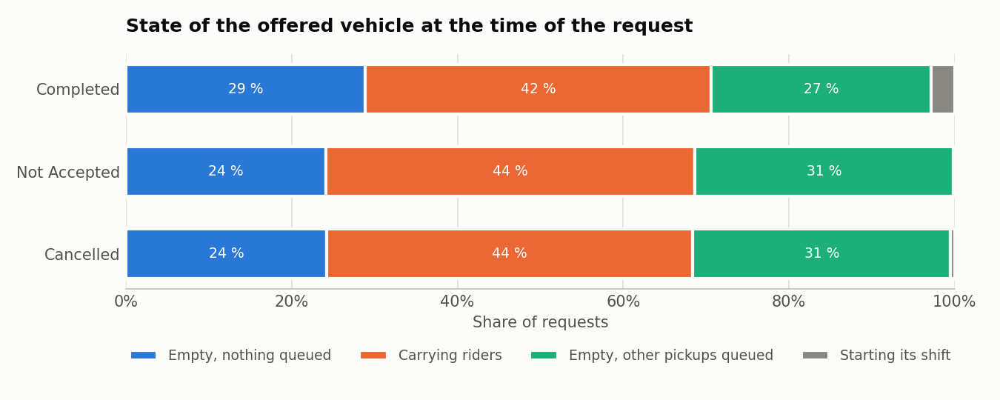
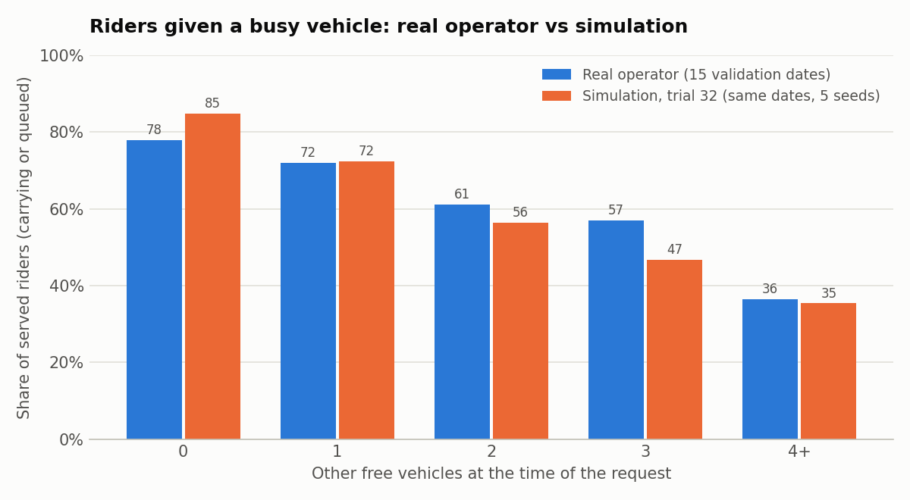
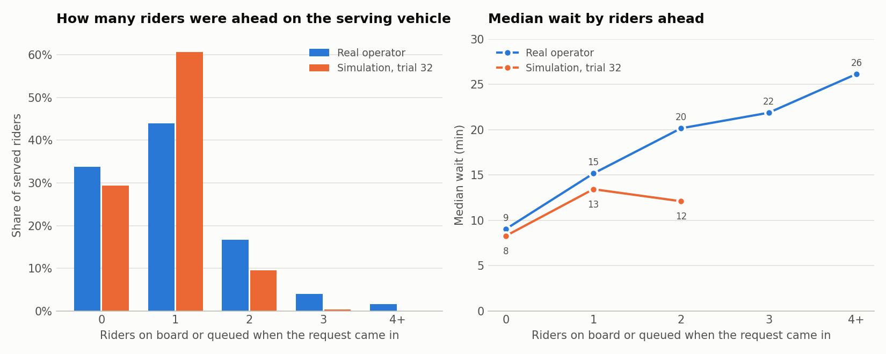

# How the real operator assigns riders to vehicles

November 2026. Part of Phase 2 of [plan.md](plan.md), written as input to Phase 3 (WI-2 and WI-5).

## Summary

- **Most riders are given a vehicle that is already busy.**
  - 71 % of riders got a vehicle that was carrying riders or had other pickups queued. Only 29 % got an empty vehicle with nothing queued.
  - In about half of those cases another vehicle was free at that moment. Even with 4 or more free vehicles, 43 % of riders were still put on a busy vehicle.
- **The simulation does the same.** On the 15 validation dates, the share of riders given a busy vehicle is almost identical in reality and in the simulation, at every number of free vehicles. **Assigning riders to busy vehicles is not where the model goes wrong.**
- **The difference is how deep the queue on each vehicle gets.**
  - Real vehicles often take a new rider with 2–4 riders already on board or queued. Each extra rider ahead adds about 5 min to the wait (median 9 → 15 → 20 → 22 → 26 min).
  - In the simulation almost no rider has more than 2 riders ahead, and the wait levels off at about 13 min.
  - This is the WI-2 mechanism seen from the vehicle's side: the model's single wait-time cap stops queues from growing, so long accepted waits never appear.
- **Most refusals happen when no vehicle is free.**
  - With the agreed availability rule, 83 % of `Seat Unavailable` refusals came at a moment when no vehicle was free.
  - When one was free, it was usually far away: median 3.1 miles in a straight line, against 1.7 miles for the vehicle that actually served a rider.
  - This fits a rule of the form "refuse if no vehicle can reach the rider soon enough". Wheelchair needs and group size do not explain refusals.
- **Riders decline at much the same rate whatever vehicle they are offered.**
  - The decline rate is 21 % when the offered vehicle is empty with nothing queued, and 25–26 % when it is busy.
  - Most declining therefore depends only weakly on the wait. This supports the WI-2 plan of a baseline decline rate with a flat dependence on the offered wait.

**Correction to the earlier Phase 2 numbers.** [findings.md](analysis/phase2/findings.md) §2 and the first version of the Phase 2 text in [plan.md](plan.md) said:
- "an idle vehicle existed for 95 % of requests" (this report: 67–82 %)
- "64 % of refusals happened while a vehicle was free" (this report: 17–67 %)

The first check counted vehicles with a pickup already queued as idle. It also did not separate time in breaks from time available. This report uses one stricter definition throughout (section 2.3) and gives both bounds where breaks matter. Both files have been updated.

## 1. Data

**Source.** These are the operator's request records for city 77 in 2024: `New folder/2024_rq_file_with_6_by_6_ODT_bins.csv`. The file is not in the repository: it is raw rider data and is kept outside the repository. It has 120 683 requests, one row per request. It is also the source of the real KPI files used for calibration.

**Scope.** This report uses the 63 dates that have demand files in `data/demand/example_demand/matched/`: 48 calibration dates and 15 validation dates. They hold 29 993 requests:

| `TRIP_OUTCOME` | Requests | Meaning used here |
|---|---|---|
| Completed | 18 418 | Rider picked up and dropped off |
| Not Accepted | 6 423 | The operator offered a vehicle and **the rider turned the offer down** (confirmed by the user, D2) |
| Cancelled | 1 909 | The rider accepted, then cancelled before pickup |
| Seat Unavailable | 1 601 | **The operator refused**: no vehicle was offered |
| Other Error / Skip Billing | 770 | Not used |
| Out of Service Hours | 678 | Request outside operating hours; not used |
| No-Showed | 192 | Rider not at the pickup; counted as busy time for the vehicle |

All requests are on demand: none are prebooked and none have a scheduled pickup time. The fleet has 16 vehicle IDs over these dates; 13 of them served at least one wheelchair rider at some point, so they are treated as wheelchair-accessible.

**Columns used.**

| Column | What it gives |
|---|---|
| `VEHICLE_ID` | The serving vehicle (completed, no-show). For declined or cancelled requests, the vehicle that was offered. |
| `REQUEST_TIME`, `ACTUAL_PICKUP_TIME`, `ACTUAL_DROPOFF_TIME` | Times, to the minute |
| `diff_pickup_request` | Wait from request to pickup, in seconds |
| `EMPTY_MILES_BEFORE` | Miles driven empty to reach the pickup |
| `ORIGIN_*`, `DESTINATION_*` (lat/lng) | Where the rider was picked up and dropped off |
| `IS_WAV_RIDER`, `NUM_PASSENGERS` | Wheelchair need and group size |

**Simulation, for comparison (section 3.7).**
- Trial-32 parameters, the trace-based fleet from Phase 2, and the per-period scaled network from Phase 1.
- The 15 validation dates, 5 seeds each.
- Produced by `docs/analysis/phase1/run_trial32_dates.py <out_dir> vali`. This is the "baseline after Phase 2" run in [plan.md](plan.md).

## 2. Method

### 2.1 Vehicle state at any minute

Each vehicle's day is rebuilt from its own trips. At a given minute *t*, a vehicle is in one of these states:

| State | Definition |
|---|---|
| **Carrying riders** | A rider is on board: pickup ≤ *t* < dropoff. |
| **Empty, other pickups queued** | Nobody on board, but another rider has been assigned to it and not yet picked up. That rider's request time is before *t* and their pickup is after *t*, or the vehicle is on the approach drive to them. |
| **Free** | Neither of the above, and the vehicle is *available*: inside its shift and not on a break (section 2.2). |
| **Starting its shift / off** | Outside its shift or on a break. |

The **approach drive** is `EMPTY_MILES_BEFORE` at the real driving speed of 27 km/h (3.58 min per mile, from Phase 1), capped at 20 min. It is the same estimate used for the availability files.

### 2.2 Shift and breaks

This is the availability rule of [build_availability.py](analysis/phase2/build_availability.py).
- **Shift:** from the vehicle's first activity to its last. Activities are approach drives, trips, and the request times of offers made with the vehicle.
- **Break:** an idle stretch inside the shift that lasts more than 20 min and contains at least one `Seat Unavailable` refusal.

**The break rule is partly circular when applied to refusals.** A refusal that falls in a long idle stretch is exactly what turns that stretch into a break. So with this rule, a vehicle idle for a long time during a refusal never counts as free. The records cannot tell whether that vehicle was really on a break or available but not used.

Every number that depends on this is therefore given twice:
- **With breaks** (the agreed rule): a lower bound on free vehicles.
- **Without breaks** (shift span only): an upper bound.

### 2.3 Counting free vehicles

For each request, the number of free vehicles is counted at its request time. The serving or offered vehicle is left out, so the count means "other vehicles that were free".

### 2.4 Where a free vehicle is

Vehicle positions are not recorded. A free vehicle is placed at the destination of its last drop-off that day. Its distance to a request is the straight-line distance in miles. A vehicle with no drop-off yet that day has an unknown position and is skipped in the distance analysis.

To check this proxy, the straight-line distance from a vehicle's last drop-off to its next pickup was compared with the `EMPTY_MILES_BEFORE` it actually drove:

| Time between drop-off and next pickup | Empty miles ÷ straight-line miles (median) |
|---|---|
| Up to 10 min | 0.73 |
| 10–20 min | 0.76 |
| 20–40 min | 0.82 |
| Over 40 min | 1.11 |

- For gaps over 40 min the ratio is 1.11, a plausible ratio of road to straight-line distance. So a vehicle that sits idle mostly stays near its last drop-off.
- Shorter gaps give ratios below 1. In those cases part of the drive happens with another rider on board, and those miles are not counted as empty.
- The proxy is therefore rough. Section 3.4 gives its results as a range.

## 3. Findings

### 3.1 Which vehicle serves a rider

State of the serving vehicle when the request came in (18 417 completed requests):

| Serving vehicle | Share | Median wait | 75th pct | 90th pct |
|---|---|---|---|---|
| Empty, nothing queued | 29 % | 9.2 min | 13.2 min | 18.3 min |
| Carrying riders | 42 % | 16.0 min | 23.0 min | 29.3 min |
| Empty, other pickups queued | 27 % | 18.1 min | 25.0 min | 31.0 min |
| Starting its shift | 3 % | 10.7 min | 17.7 min | 24.9 min |
| All | | 14.0 min (mean 15.6) | | |



**Figure 1.** State of the serving vehicle at the time of the request, by request hour. 63 dates, all completed requests.

**By hour:**
- Free vehicles serve about half the riders at 7:00 and 11:00, and 41 % at 12:00.
- They serve only 12 % at 15:00 and 18 % at 16:00, the PM peak.
- "Starting its shift" is common only at 7:00, when a vehicle's first rider of the day requested before the vehicle started.

### 3.2 How long riders wait, by vehicle state



**Figure 2.** Wait from request to pickup, by state of the serving vehicle.

- **Riders who got a free vehicle waited the drive plus about 3 min.** Their wait minus the estimated approach drive has a median of 3.1 min (interquartile range 0.2–6.3 min). The 3 min covers dispatch and the driver setting off.
- **A free vehicle was therefore really available when used.**
- **Being put on a busy vehicle costs a median of 7–9 min extra.**

### 3.3 Busy vehicles are chosen even when others are free

- **Riders given a busy vehicle:** 71 % (carrying riders or with pickups queued).
- **Of those, another vehicle was free at that moment:** 53 % with breaks, 74 % without.
- **Requests with at least one free vehicle anywhere:** 67 % with breaks, 82 % without.
- **Median waits:**
  - put on a busy vehicle while another was free: 14.3 min
  - put on a busy vehicle with none free: 20.0 min
  - given a free vehicle: 9.2 min



**Figure 3.** Share of riders given a busy vehicle, by how many other vehicles were free at the time (with breaks).

The more vehicles are free, the less often a busy vehicle is chosen, but the share never comes close to zero:

| Other free vehicles | 0 | 1 | 2 | 3 | 4+ |
|---|---|---|---|---|---|
| Given a busy vehicle | 83 % | 74 % | 63 % | 60 % | 43 % |

So the operator does not simply send the nearest free vehicle. It adds riders to existing routes much of the time.

### 3.4 Was the free vehicle closer?

This compares requests that were given a busy vehicle while another vehicle was free and had a known position (6 917 requests).
- **Distance:** the nearest free vehicle was a median 1.7 miles away in a straight line. That is the same distance as for riders who were given a free vehicle (1.7 miles from their vehicle's last drop-off).
- **Estimated pickup by the nearest free vehicle:** its distance × road factor × 3.58 min/mile, plus 3.1 min.
  - Road factor 0.84 (the median measured in section 2.4): sooner than the actual wait for **74 %** of these riders, and at least 5 min sooner for 49 %.
  - Road factor 1.3 (a typical road-to-straight-line ratio): sooner for **59 %**, and at least 5 min sooner for 36 %.



**Figure 5.** Straight-line distance from the request origin:
- to the serving vehicle's last drop-off, for riders given a free vehicle;
- to the nearest other free vehicle, for riders given a busy vehicle;
- to the nearest free vehicle, for refusals.

**Reading.** In roughly half to three quarters of these cases, a free vehicle could probably have picked the rider up sooner. The operator does not minimise each rider's wait.
- That is what an insertion heuristic does when it also weighs the distance driven or keeps vehicles near their own routes. FleetPy's control objective (`distance_and_user_times_with_walk`) works this way.
- Positions are approximate (section 2.4), so treat these numbers as a range, not a measurement.

### 3.5 Refusals (`Seat Unavailable`)



**Figure 4.** Number of free vehicles at the moment of the request (with breaks), for completed requests, refusals and declined offers. For completed and declined requests the serving or offered vehicle is left out.

- **No vehicle free:** 83 % of the 1 601 refusals (with breaks). Without breaks the share with a free vehicle rises from 17 % to 67 %, because of the circularity in section 2.2. The data cannot settle this, so the honest answer is a range.
- **When a vehicle was free, it was usually far away:** median 3.1 miles in a straight line, only 32 % within 2 miles (Figure 5). For riders given a busy vehicle while another was free, the nearest free vehicle was 1.7 miles away.

**By hour:**

| Hour | 7 | 8 | 9 | 10 | 11 | 12 | 13 | 14 | 15 | 16 | 17 | 18 |
|---|---|---|---|---|---|---|---|---|---|---|---|---|
| Refusals | 53 | 125 | 209 | 79 | 19 | 40 | 107 | 77 | 449 | 214 | 132 | 97 |
| With a free vehicle | 6 % | 14 % | 17 % | 20 % | 37 % | 30 % | 32 % | 30 % | 8 % | 14 % | 16 % | 37 % |

- **Peaks:** the PM peak (15:00–17:00) has half of all refusals, and almost none with a free vehicle. Those refusals are real capacity shortages.
- **Middle of the day:** about a third of refusals had a free vehicle somewhere, usually far away.

**What does not explain refusals:**
- **Wheelchair need:** 3.7 % of refusals vs 2.8 % of completed trips. Only 60 refusals were for wheelchair riders, and 23 % of those had a free wheelchair-accessible vehicle.
- **Group size:** 6.6 % of refusals were for groups vs 11.3 % of completed trips.
- **Trip length:** refused trips are only slightly longer (median 1.69 vs 1.54 straight-line miles).

### 3.6 Declined offers and cancellations

98 % of declined offers record the vehicle that was offered, and so do all cancellations. That allows a comparison with completed trips:



**Figure 6.** State of the offered vehicle at the time of the request. For completed trips the offered vehicle is the serving vehicle.

| Offered vehicle | Completed | Declined | Cancelled | **Decline rate** |
|---|---|---|---|---|
| Empty, nothing queued | 5 315 | 1 526 | 463 | **20.9 %** |
| Carrying riders | 7 687 | 2 810 | 843 | **24.8 %** |
| Empty, other pickups queued | 4 892 | 1 972 | 594 | **26.4 %** |

The decline rate is declined ÷ (completed + declined + cancelled) for each vehicle state.
- An offer from a busy vehicle means a pickup about 7–9 min later (section 3.2), yet it is declined only 4–5 points more often.
- **About 21 % of riders decline even the quickest offers.** Most declining therefore does not depend on the wait.
- Cancellations follow the same pattern.
- This matches the WI-2 finding that the real decline rate is 17–32 % and responds only weakly to load.

### 3.7 Real operator vs simulation

Same 15 validation dates. Real: 4 479 completed requests. Simulation: trial 32, 24 514 served riders over 5 seeds.

| | Real | Simulation |
|---|---|---|
| Rider given a vehicle that is empty, nothing queued | 31 % | 29 % |
| … carrying riders | 40 % | 49 % |
| … empty, other pickups queued | 26 % | 22 % |
| Given a busy vehicle while another vehicle was free | 54 % | 43 % |
| Median wait, empty vehicle with nothing queued | 8.9 min | 8.3 min |
| Median wait, carrying riders | 15.6 min | 13.1 min |
| Median wait, other pickups queued | 18.0 min | 13.9 min |
| Median wait, all served riders | 13.7 min | 11.7 min |
| Riders ahead on the serving vehicle (mean) | 0.96 | 0.81 |
| … of which queued, not yet picked up (mean) | 0.50 | 0.31 |



**Figure 7.** Share of served riders given a busy vehicle, by number of other free vehicles: real operator vs simulation, same dates. In the simulation, "off" means out of service or driving to a depot.

**The model already assigns riders to busy vehicles as often as the real operator does,** at every level of free vehicles.



**Figure 8.** Left: how many riders were on board or queued on the serving vehicle when the request came in. Right: median wait by that number. Points based on fewer than 0.5 % of riders are hidden.

| Riders ahead | 0 | 1 | 2 | 3 | 4+ |
|---|---|---|---|---|---|
| Real: share of riders | 34 % | 44 % | 17 % | 4.0 % | 1.7 % |
| Real: median wait | 9.0 | 15.2 | 20.2 | 21.9 | 26.1 min |
| Simulation: share of riders | 29 % | 61 % | 9.5 % | 0.4 % | 0.0 % |
| Simulation: median wait | 8.3 | 13.4 | 12.1 | (12.3) | — |

This is where the model and reality part ways:
- **Real vehicles build longer queues.** 22 % of real riders joined a vehicle with 2 or more riders ahead, against 10 % in the simulation.
- **Real waits keep rising with each rider ahead.** In the simulation they level off: a rider joining a vehicle with 2 riders ahead waits no longer than one joining a vehicle with 1.
  - FleetPy only accepts an insertion that keeps every rider's pickup within the wait-time cap and every on-board rider within the detour limit. Riders whose offered wait is high decline, and leave the schedule.
  - Queues therefore never grow deep enough to produce the real 20–26 min waits.
- **This is the WI-2 mechanism of [plan.md](plan.md), seen per vehicle.** It explains the peak wait deficit better than either supply (Phase 2 result) or assignment preference (Figure 7).

## 4. What this means for Phase 3

1. **Do not change which vehicle the model picks.** FleetPy's insertion heuristic already assigns riders to busy vehicles about as often as the real operator does (Figure 7). Changing the assignment preference would fix something that is not broken.
2. **WI-2: let accepted waits grow with queue depth.**
   - Real vehicles take a new rider with 2–4 riders already ahead, at 20–26 min waits.
   - The model needs a wait limit for accepted offers that is not also the point where every rider declines, plus a decline rate that depends only weakly on the offered wait.
   - Real decline rates are 21 % for the quickest offers and 26 % for queued vehicles (section 3.6). That suggests a baseline of about 20 % and a shallow slope.
3. **WI-2: a refusal rule that matches the real refusals.**
   - Most refusals come when no vehicle is free (83 % with breaks), largely in the PM peak.
   - The rest come with a free vehicle that is far away (median 3.1 miles).
   - A rule of the form "refuse if no vehicle, free or busy, can pick the rider up within a limit" should cover both cases. That limit must be separate from the much longer waits accepted on queued vehicles.
4. **WI-5 (pooling):** at the moment of their own pickup, 18 % of real riders shared the vehicle with a rider already on board. The pooling tests planned for Phase 3 should report the simulated equivalent alongside this number.
5. **Check of the Phase 3 changes:** rerun this analysis on the new simulation. The riders-ahead pattern in Figure 8 (share and wait by riders ahead) is the most direct test that the WI-2 change works.

## 5. Limitations

- **Minute resolution.** Request, pickup and drop-off times are recorded to the minute; only the wait (`diff_pickup_request`) is in seconds. States are judged at minute level, so requests in the same minute can be ordered wrongly.
- **Breaks are not recorded.** Section 2.2 explains the circularity. Numbers that depend on it are given as a range.
- **Positions are approximate.** Section 2.4 explains the proxy. Section 3.4 is an estimate.
- **Offers are only partly visible.** Each record shows the final vehicle, not the offered wait or whether other vehicles were considered. The operator's actual algorithm and its limits are unknown; this report describes what it did, not why.
- **Wheelchair capability is inferred.** A vehicle counts as wheelchair-accessible if it served a wheelchair rider on any date.
- **The simulation side is one run** (trial 32, 5 seeds) and uses FleetPy's assignment time, which is the request time.

## 6. Reproducing

All commands run from the repository root and need the raw request file in `New folder/`.

```
python docs/analysis/phase2/operator_dispatch.py --no-figures                  # all real-side numbers
python docs/analysis/phase1/run_trial32_dates.py <run_dir> vali                 # simulation, 15 dates (~90 min)
python docs/analysis/phase2/operator_dispatch.py --sim <run_dir>               # + section 3.7 and all figures
```

- The figures are written to `docs/figures/real_operator_dispatch/`.
- [dispatch_checks.py](analysis/phase2/dispatch_checks.py) is the earlier, looser version of sections 3.1–3.5. It is superseded by [operator_dispatch.py](analysis/phase2/operator_dispatch.py).
